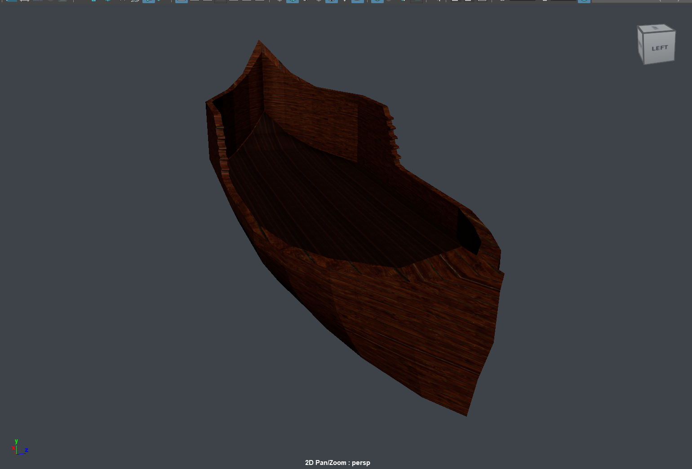
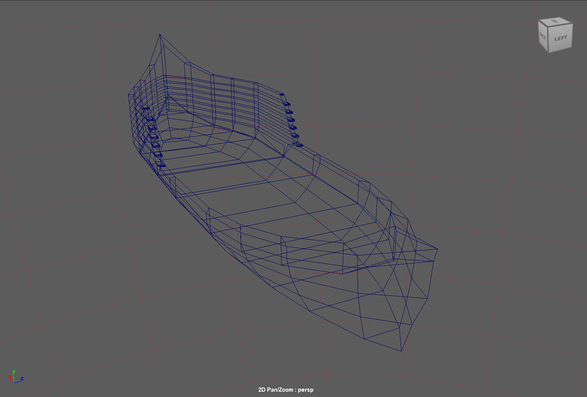
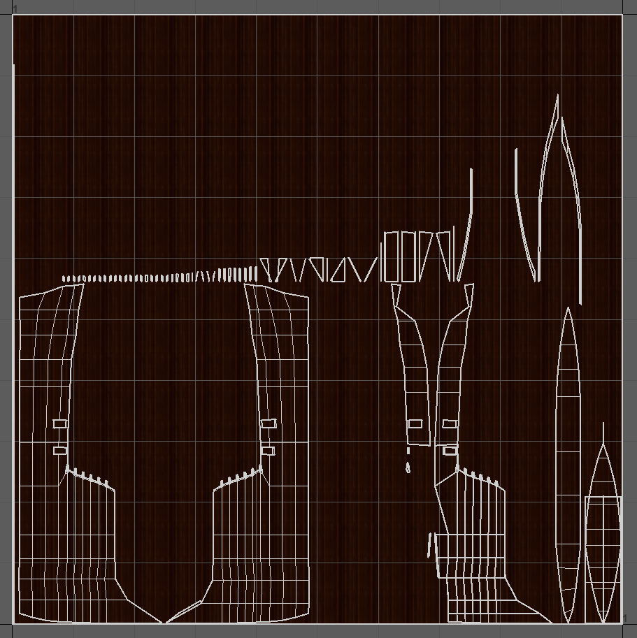
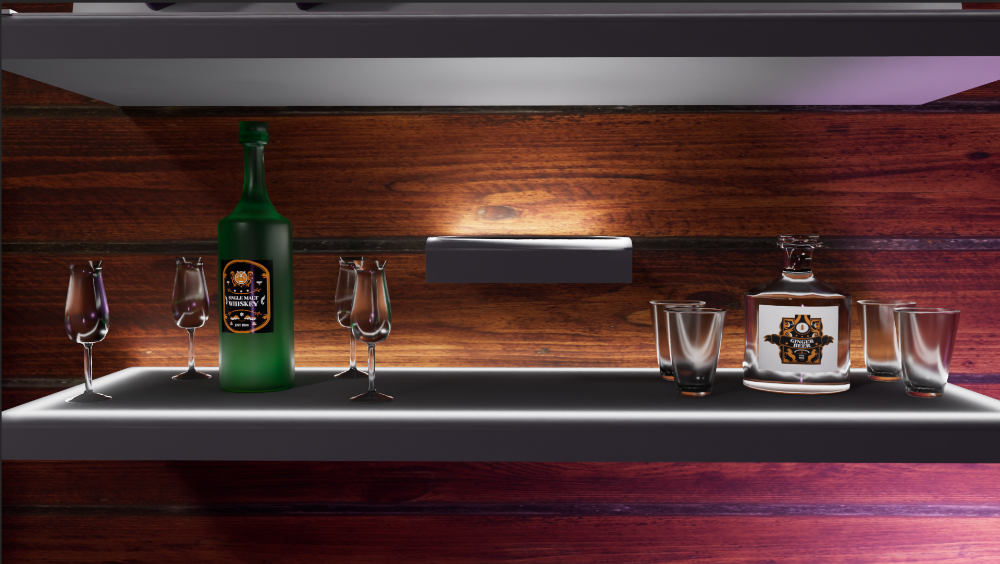
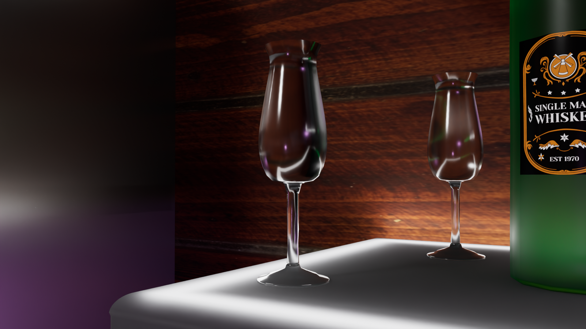
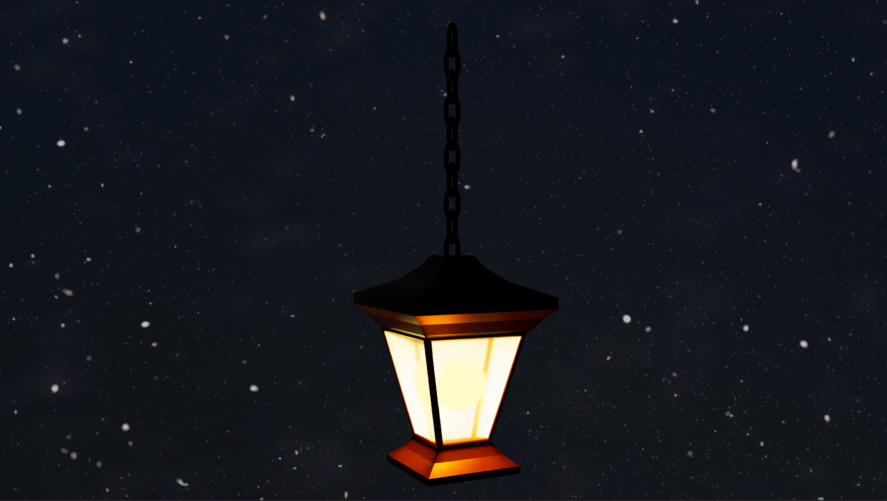
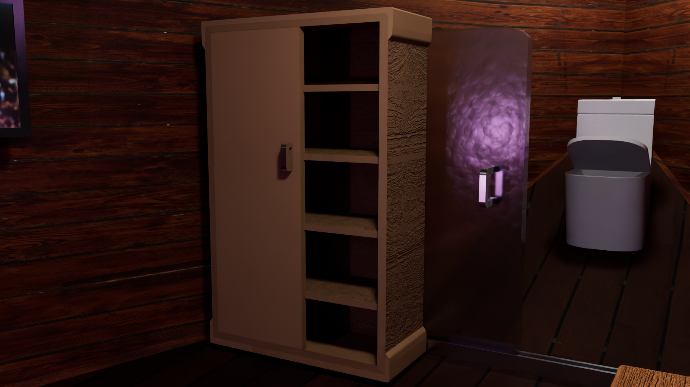
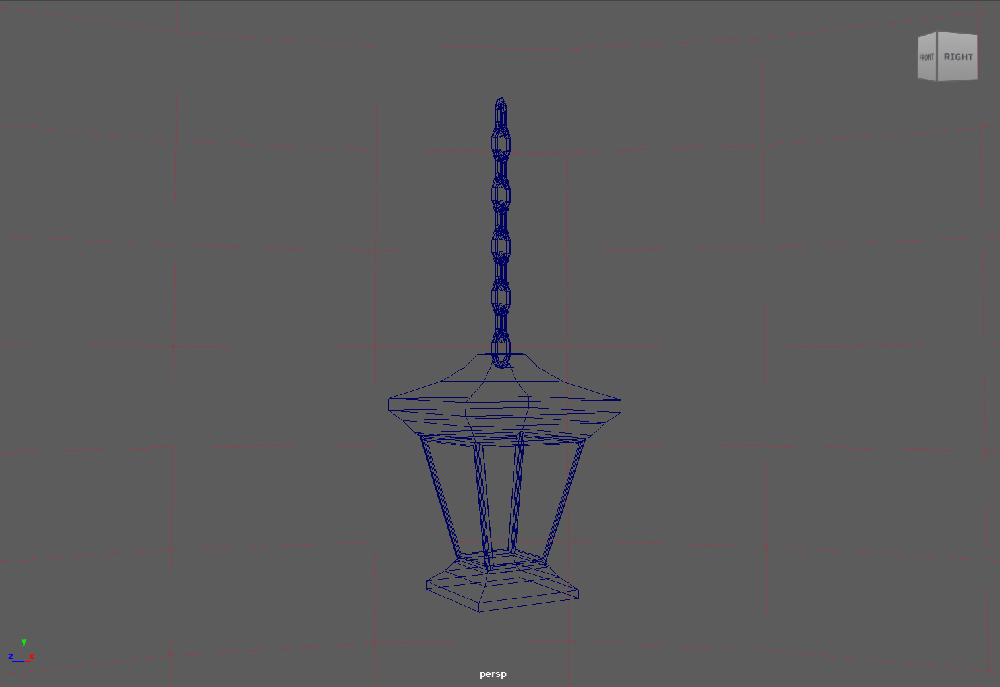
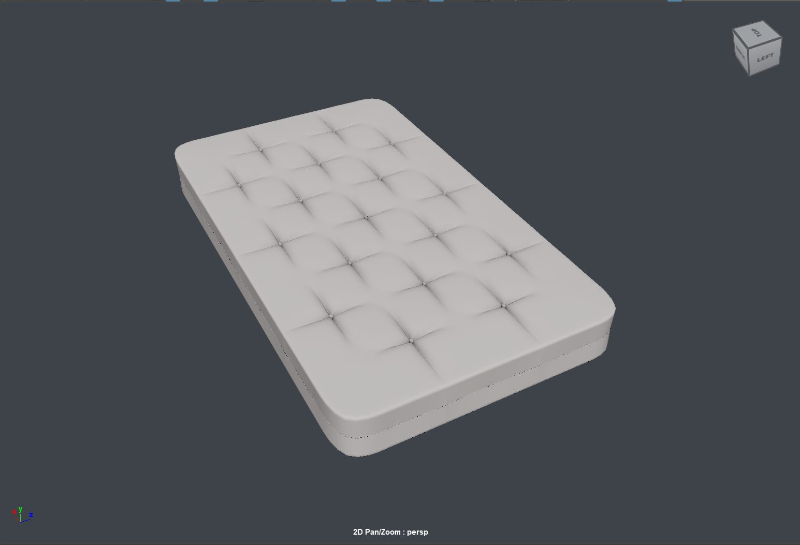

# 🏴‍☠️ Reimagined Pirate Ship Environment

## 📖 Overview

**Reimagined Pirate Ship Environment** is a 3D environment design project created in **Autodesk Maya**, built around the idea of a traditional pirate ship with an unexpectedly modern interior.

The exterior and overall structure retain the visual identity of a pirate ship, while the interior introduces contemporary furniture, appliances, materials and everyday objects. This contrast between historical exterior design and modern living spaces forms the central concept of the environment.

The project was developed through 3D modelling, scene composition, material and texture setup, lighting and rendering, with a focus on creating a cohesive environment despite the deliberate contrast between its exterior and interior styles.

<br/>


## ✨ Key Features

### 🏴‍☠️ Pirate Ship Exterior

- **Traditional Ship Identity:** The overall structure and exterior are designed around the recognisable visual language of a pirate ship
- **Maritime Environment:** Ship-based forms and architectural elements establish the historical exterior setting
- **Exterior–Interior Contrast:** The traditional exterior provides a deliberate contrast to the contemporary spaces inside

### 🏠 Modern Interior

- **Contemporary Living Space:** The ship interior is reimagined using modern furniture, appliances and everyday objects
- **Design Contrast:** Contemporary elements are placed within the historical ship structure to create an intentionally unexpected environment
- **Cohesive Composition:** Modern objects are arranged and presented as part of a functional interior rather than isolated props

### 🧱 3D Modelling & Scene Composition

- **Environment Modelling:** 3D geometry is used to construct and populate the ship environment
- **Spatial Composition:** Interior objects and environmental elements are arranged to create a coherent scene
- **Prop Integration:** Multiple props and furnishings contribute to the detail and identity of the modern interior

### 🎨 Materials & Texturing

- **Texture-Based Materials:** Image textures are used across surfaces including wood, metal, walls, flooring and props
- **Material Variation:** Different surface treatments help distinguish the traditional ship structure from the contemporary interior
- **Custom Visual Details:** Additional image-based elements and labels are incorporated into selected props

### 💡 Lighting & Presentation

- **Environment Lighting:** Lighting is used to establish atmosphere and improve readability of the interior
- **HDRI-Based Environment:** A sky/environment texture contributes to the overall lighting setup
- **Rendered Presentation:** The environment is prepared for rendered visual output using Arnold

<br/>


## 🛠️ Technical Specifications

- **3D Software:** Autodesk Maya 2026.2
- **Project Format:** Maya Binary (`.mb`)
- **Rendering:** Arnold
- **Project Type:** 3D Environment Design
- **Core Skills:** 3D Modelling, Environment Design, Scene Composition, Texturing, Material Setup and Lighting
- **Texture Management:** Maya `sourceimages` workflow with relative project paths
- **Primary Scene:** `scenes/Project.mb`

<br/>

## 📋 Requirements

### Software Requirements

- **Autodesk Maya 2026.2**
- **Arnold Renderer** for rendered output
- A system capable of handling textured 3D environments and Arnold rendering

### Project Assets

The repository includes the Maya scene and the texture files required by the final environment.

- Main Maya scene
- Referenced texture files
- HDRI/environment image
- Maya workspace configuration

<br/>


## 🚀 Project Setup

### 1. Clone the Repository

```bash
git clone https://github.com/YOUR-USERNAME/Reimagined-Pirate-Ship-Environment.git
cd Reimagined-Pirate-Ship-Environment
```

### 2. Set the Maya Project

- Open **Autodesk Maya**
- Go to **File → Set Project**
- Select the cloned repository folder
- Confirm the project directory

### 3. Open the Scene

Open:

```text
scenes/Project.mb
```

The scene uses relative paths to locate the required textures inside the project's `sourceimages` directory.

### 4. Verify External Files

If required, open:

**Windows → General Editors → File Path Editor**

Check that all referenced texture files are resolved correctly.

<br/>


## 📁 Project Structure

```text
Reimagined-Pirate-Ship-Environment/
│
├── scenes/
│   └── Project.mb
│
├── sourceimages/
│   ├── Environment textures
│   ├── Surface textures
│   ├── Prop textures
│   └── HDRI / sky image
│
├── images/
│   └── Rendered images and project visuals
│
├── workspace.mel
├── .gitignore
└── README.md
```

### Main Scene

`scenes/Project.mb` contains the complete 3D environment.

### Source Images

`sourceimages/` contains the texture files referenced by the Maya scene. The project uses relative paths so the scene can resolve these assets after the repository is cloned.

### Images

`images/` is used for rendered outputs and visual documentation of the environment.

<br/>

## 🏗️ Environment Breakdown

### 🏴‍☠️ Traditional Exterior

The exterior preserves the recognisable identity of a pirate ship, establishing the historical setting before the contrasting interior is revealed.

- Pirate-ship-inspired structure and silhouette
- Wood-based materials and maritime visual elements
- Exterior composition designed to establish the traditional setting
- Environment lighting and sky imagery used to support the overall atmosphere

### 🏠 Contemporary Interior

The interior intentionally shifts away from the traditional exterior and introduces a modern living environment within the ship.

- Contemporary furniture and household elements
- Modern appliances integrated into the ship interior
- Materials and textures used to distinguish modern interior surfaces from the traditional exterior
- Spatial arrangement designed to make the interior feel functional while maintaining the surrounding ship structure

### 🎨 Materials, Textures & Lighting

The environment combines multiple materials and image-based textures to establish variation across the ship and its interior.

- Wood, metal, wall, floor and prop textures
- Custom image-based details applied to selected objects
- HDRI/environment imagery used as part of the scene presentation
- Arnold rendering used to evaluate lighting, materials and the overall environment

<br/>


## 📝 Credits & Third-Party Assets

Developed as an individual 3D environment project as part of the MSc Immersive Technologies programme at the University of Bristol.

### Tools

- Autodesk Maya
- Arnold Renderer

### Third-Party Assets & Textures

The project incorporates third-party textures, HDRI imagery and other visual resources where applicable.

All third-party content remains subject to the licences and terms of use provided by its respective creators and distributors.

The Maya scene and repository structure have been prepared for portfolio and educational presentation.

<br/>


## 🔮 Future Enhancements

Potential future improvements include:

- Further refine the modelling and detailing of the pirate ship exterior
- Expand the modern interior with additional rooms, furniture and environmental props
- Improve material consistency and surface detail across the environment
- Refine UV mapping for selected models and props
- Explore transferring the environment into Unity Engine for an immersive walkthrough

<br/>

## 🖼️ Gallery
<p align="center">
  
</p>
<p align="center">
  
  
</p>
<p align="center">
  
</p>
<p align="center">
  
  
</p>
<p align="center">
  
  
</p>
<p align="center">
  
  
</p>
